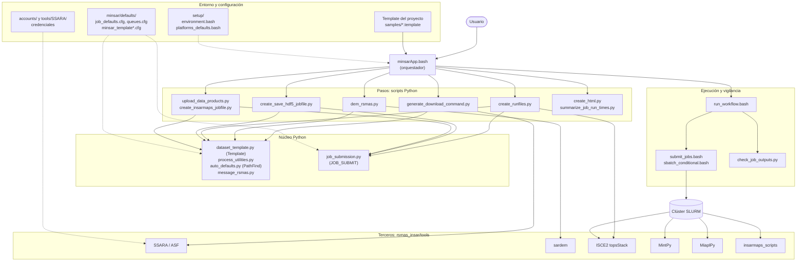
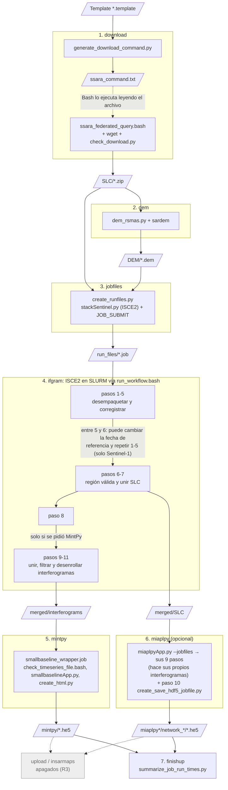
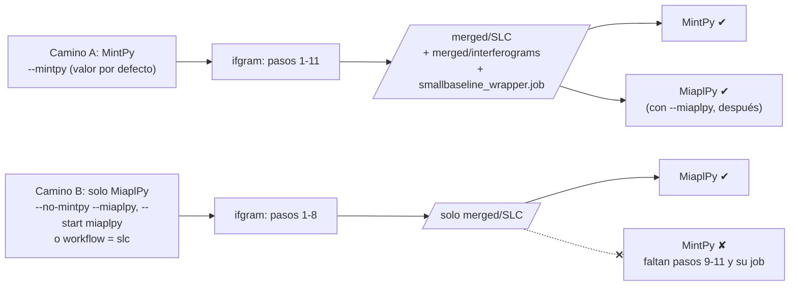
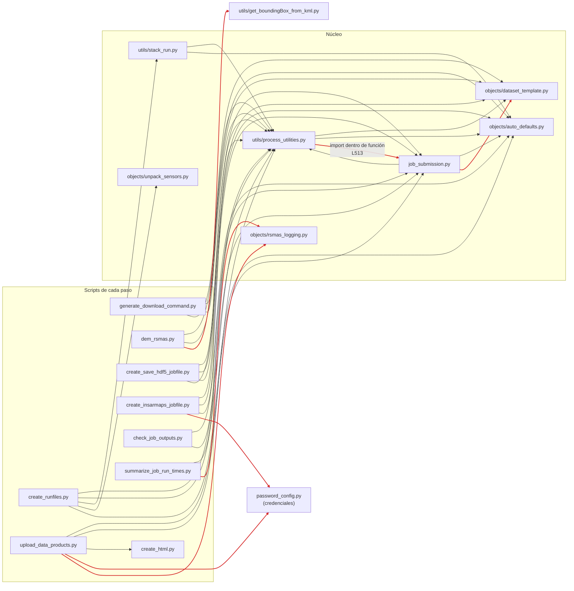
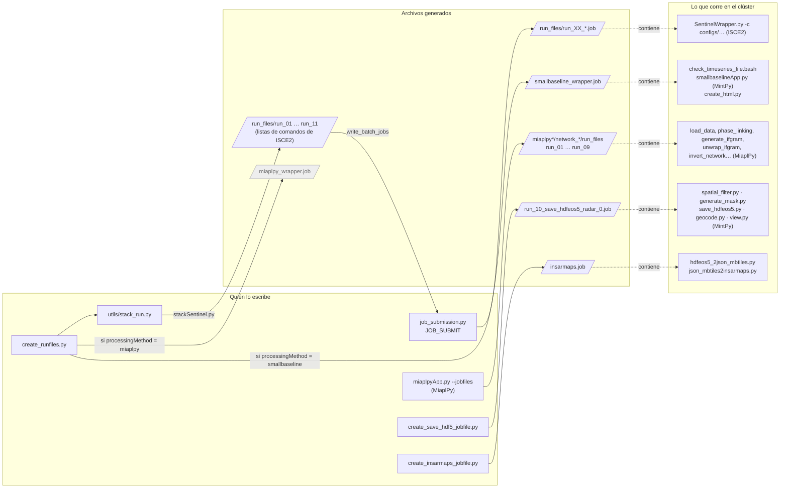

# Diagramas

Cinco diagramas en [Mermaid](https://mermaid.js.org/). GitHub y VS Code (con la extensión "Markdown Preview Mermaid Support") los muestran como gráficos. Cada uno responde una sola pregunta:

| # | Pregunta | Fuente |
|---|---|---|
| 1 | ¿Cuáles son las piezas grandes y quién usa a quién? | Lectura del código |
| 2 | ¿Qué pasos sigue un proyecto y qué produce cada uno? | Lectura + grafo, corregido con la revisión del 06-11-2026 |
| 3 | ¿Por qué con MintPy se puede correr MiaplPy, pero no al revés? | Lectura guiada por el grafo completo |
| 4 | ¿Qué módulos Python dependen de cuáles? (para modularizar) | Grafo, verificado contra la lectura |
| 5 | ¿Qué programas quedan escritos dentro de los `.job`? | Grafo |

Los números de línea de cada llamada están en [`resultados/HUECOS_REPORTE.md`](resultados/HUECOS_REPORTE.md#flujo-de-minsarappbash-por-paso). El grafo completo se explora en [`resultados/grafo.html`](resultados/grafo.html).

---

## 1. Componentes

El usuario solo interactúa con `minsarApp.bash`. Este llama a los **pasos** Python, que se apoyan en el **núcleo** compartido, y a la capa de **ejecución**, que envía trabajos al clúster. El cálculo científico ocurre en las herramientas de **terceros**. Las flechas punteadas son lectura de configuración o credenciales.

---

## 2. Flujo por pasos

Cada caja es un paso de `minsarApp.bash` (un bloque `if [[ $<paso>_flag == "1" ]]`). Los paralelogramos son archivos. Lo importante: **el paso ifgram no siempre corre los mismos pasos de ISCE2**, y MintPy y MiaplPy **leen cosas distintas**. El diagrama 3 explica por qué.

- **Paso 8:** con `topsStack.workflow = interferogram` es `generate_burst_igram`; con `workflow = slc` es `grid_baseline`.
- **Omitido:** la variante `--chunks`, que divide la zona y lanza un `minsarApp.bash` por franja ([04 §4.10](04-flujo-de-datos.md#410-variante-procesamiento-por-trozos---chunks)).

---

## 3. El camino MintPy / MiaplPy

MiaplPy no usa los interferogramas de ISCE2: lee `merged/SLC` y hace los suyos. MintPy, en cambio, necesita `merged/interferograms`, que solo existe si ISCE2 corrió los pasos 9 a 11. Por eso **elegir MintPy deja abierto MiaplPy, pero elegir solo MiaplPy cierra MintPy**.

Tres configuraciones deciden el camino, y las tres empujan en el mismo sentido:

| Configuración | Dónde se aplica | Camino A | Camino B |
|---|---|---|---|
| `--mintpy` / `--no-mintpy --miaplpy` / `--start miaplpy` | `minsarApp.bash:222-258`, `:441-444` y `:695-697` | ifgram hasta el paso 11 | ifgram hasta el paso 8 |
| `topsStack.workflow` (template) | `stackSentinel.py:1028-1043` y `minsarApp.bash:530-531` | `interferogram`: ISCE2 genera los pasos de interferogramas | `slc`: ISCE2 no los genera y MinSAR **apaga MintPy a la fuerza** |
| `processingMethod` (template) | `create_runfiles.py:239-254` | `smallbaseline`: escribe `smallbaseline_wrapper.job` | `miaplpy`: escribe `miaplpy_wrapper.job` y no el de MintPy |

Las excepciones y los puntos por confirmar están en [R23](riesgos.md#r23).

---

## 4. Dependencias entre módulos Python

Solo imports entre módulos propios: es el mapa para modularizar. **No se dibuja `message_rsmas.py`**: lo usan 30 archivos y llenaría el diagrama de flechas. Los nodos con más flechas entrantes (`process_utilities.py`, `auto_defaults.py`, `job_submission.py`) son los más delicados de cambiar.

Las flechas en **rojo** se agregaron al validar con el grafo ([validacion.md §1](validacion.md#1-fuentes-y-límites)). La de `process_utilities → job_submission` cierra una dependencia circular ([R21](riesgos.md#r21)).

---

## 5. Qué se escribe dentro de los `.job`

Buena parte del pipeline no aparece como llamadas en el código: **se escribe como texto** dentro de archivos que después ejecuta SLURM. Todos pasan por `run_workflow.bash` ([04 §4.5](04-flujo-de-datos.md#cómo-se-ejecuta-cada-paso-en-el-clúster)). En gris, lo que se genera pero no se usa.

`miaplpy_wrapper.job` se escribe pero `minsarApp.bash` nunca lo usa: lanza MiaplPy con `srun miaplpyApp.py --jobfiles` ([R23](riesgos.md#r23)).

---
Anterior: [04-flujo-de-datos.md](04-flujo-de-datos.md) · Siguiente: [guia-de-mantenimiento.md](guia-de-mantenimiento.md)
